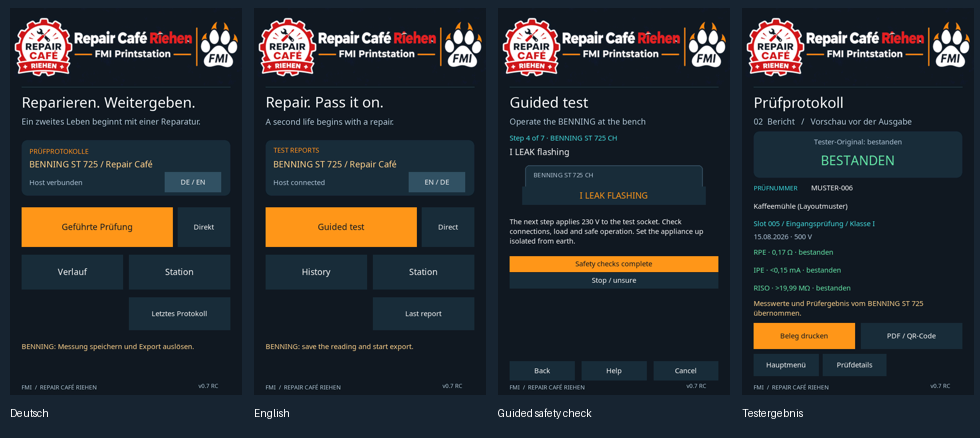
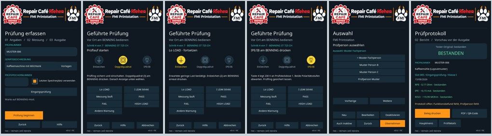
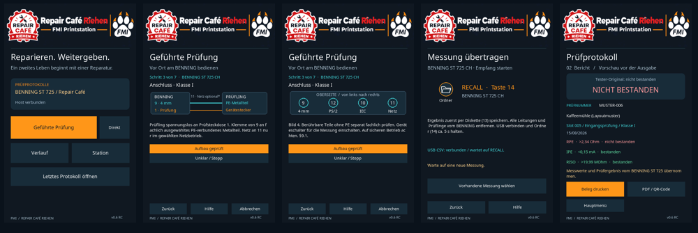
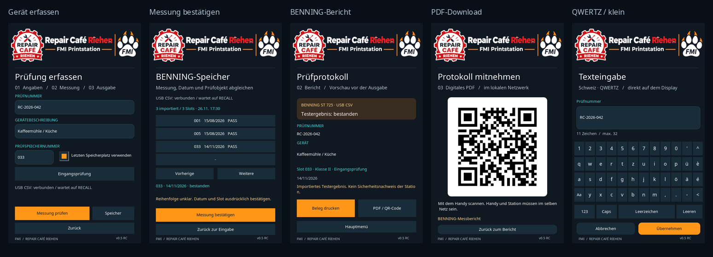

# Repair Café Print Station

Development prototype for Repair Café Riehen. Python 3.11+ on Raspberry Pi 4B, later Orange Pi Zero 3. Nextion NX8048T070_011 HMI, Epson network ESC/POS printer and modular electrical safety tester integration.

## First boot

Back up the existing SD card. Inspect existing services and network configuration before changing anything. Do not enable a DHCP server on a shared network. The prototype does not modify system services or networking.

```sh
python3 station.py diagnose
python3 station.py simulate --ticket DEV-001 --device 'Demo appliance'
python3 station.py history
python3 -m unittest discover -s tests
```

Printer test (replace IP with the actual printer address):

```sh
python3 station.py printer-test --host 10.88.77.30
```

Nextion probe (verify voltage levels, power and UART availability first; use a suitable USB TTL adapter if needed):

```sh
sudo apt install python3-serial
python3 station.py display-test --port /dev/ttyUSB0 --baud 9600
```

`station.py simulate` writes a visibly marked simulation. Imported BENNING records preserve the original tester verdict and do not constitute independent certification by the station. The installed Epson is at `169.254.25.23:9100`. The Pi Ethernet address is `169.254.100.1/16`.

## v0.7 candidate · Deutsch / English

One native HMI switches between German and English. Each saved report keeps its selected language. The compact v0.6.2 receipt and A4 layouts use localised verdicts, dates and resistance units.



- [Operation, microSD installation and rollback](docs/bilingual-v07.md)
- [Editable bilingual HMI](hmi/build/FMI_RC_native_v0_7.zip) and [artifact checksums](hmi/build/manifest-v07.json)
- [Validation and physical bench checklist](hmi/VALIDATION-v07.md)

## v0.6.1 Bedienung am Prüfstand

Netzbetrieb und 500 V für geeignete Standardprüfungen, gelb hervorgehobene Prüftasten, Namensliste und Gerätevorlagen. Das BENNING-Urteil und der Prüfstatus bleiben separat.



- [Bedienung, microSD-Installation und Rollback](docs/operator-usability-v061.md)
- [Editable v0.6.1 HMI (ZIP)](hmi/build/FMI_RC_native_v0_6_1.zip) und [Prüfsummen](hmi/build/manifest-v061.json)
- [Bench-Abnahme](hmi/VALIDATION-v061.md)

## Guided testing v0.6 candidate



Geführte Prüfung für BENNING ST 725 CH (050317), Direktmodus, eigener Import-Warteschritt und kompakte Messwertübersicht. Das Tester-Originalergebnis erscheint auf Display, Epson-Beleg und A4-PDF.

- [Bedienung, Pi 4 und Rollback](docs/guided-v06.md)
- [Zuordnung zum Schweizer BENNING-Handbuch 12/2021](docs/benning-guided-workflows.md)
- [Editable v0.6 HMI (ZIP)](hmi/build/FMI_RC_native_v0_6.zip) und [Prüfsummen](hmi/build/manifest-v06.json)
- [Simulator- und Hardwareprüfungen](hmi/VALIDATION-v06.md)

## BENNING v0.5 candidate



Native BENNING ST 725 USB CSV import, operator-confirmed memory slots, graphical receipts and branded A4 PDFs. The Raspberry Pi 4B remains the target. Mini-DIN RS232 printing and TXT parsing are experimental.

- [Operator guide, USB bench diagnostic, Pi 4 installation and rollback](docs/benning-v05.md)
- [Editable v0.5 HMI (extract ZIP)](hmi/build/FMI_RC_native_v0_5.zip) and [artifact hashes](hmi/build/manifest-v05.json)
- [Validation completed and pending](hmi/VALIDATION-v05.md)
- [Native UART protocol](docs/native-hmi-protocol.md)

## Native v0.4 candidate


The separate candidate adds native WLAN, printer, receipt and system settings for the Pi 4B and NX8048T070_011R at 270° (480 × 800), 115200 baud. The working v0.3 deployment remains the rollback baseline. Its official Editor keyboard rename is retained.

- [Pi 4 operator setup, services and rollback](docs/native-v04.md)
- [Validation and December 12 bench checklist](hmi/VALIDATION-v04.md)
- [Editable v0.4 HMI (extract ZIP)](hmi/build/FMI_RC_native_v0_4.zip)
- [Protocol](docs/native-hmi-protocol.md)
- [Roadmap](ROADMAP.md)

The existing Epson receipt banner and feed are preserved at default settings. Every report is still a simulation and is labelled accordingly. Bench-test v0.4 separately before adopting it.
