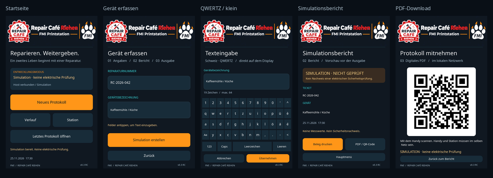

# Repair Café Print Station

Development prototype for Repair Café Riehen. Python 3.11+ on Raspberry Pi 4B, later Orange Pi Zero 3. Nextion NX8048T070_011 HMI, Epson network ESC/POS printer and modular electrical safety tester integration.

## First boot

Back up the existing SD card. Inspect existing services and network configuration before changing anything. Do not enable a DHCP server on a shared network. The prototype does not modify system services or networking.

```sh
python3 station.py diagnose
python3 station.py simulate --ticket DEV-001 --device 'Demo appliance'
python3 station.py history
python3 -m unittest discover -s tests
```

Printer test (replace IP with the actual printer address):

```sh
python3 station.py printer-test --host 10.88.77.30
```

Nextion probe (verify voltage levels, power and UART availability first; use a suitable USB TTL adapter if needed):

```sh
sudo apt install python3-serial
python3 station.py display-test --port /dev/ttyUSB0 --baud 9600
```

`station.py simulate` writes a visibly marked simulation. Imported BENNING records preserve the original tester verdict and do not constitute independent certification by the station. The Gen 3 printer at `169.254.223.252:9100` and previous native HMI have been tested on the station.

## BENNING v0.5 candidate


Native BENNING ST 725 USB CSV import, operator-confirmed memory slots, graphical receipts and branded A4 PDFs. The Raspberry Pi 4B remains the target. Mini-DIN RS232 printing and TXT parsing are experimental.

- [Operator guide, USB bench diagnostic, Pi 4 installation and rollback](docs/benning-v05.md)
- [Editable v0.5 HMI (extract ZIP)](hmi/build/FMI_RC_native_v0_5.zip) and [artifact hashes](hmi/build/manifest-v05.json)
- [Validation completed and pending](hmi/VALIDATION-v05.md)
- [Native UART protocol](docs/native-hmi-protocol.md)

## Native v0.4 candidate



The separate candidate adds native WLAN, printer, receipt and system settings for the Pi 4B and NX8048T070_011R at 270° (480 × 800), 115200 baud. The working v0.3 deployment remains the rollback baseline. Its official Editor keyboard rename is retained.

- [Pi 4 operator setup, services and rollback](docs/native-v04.md)
- [Validation and December 12 bench checklist](hmi/VALIDATION-v04.md)
- [Editable v0.4 HMI (extract ZIP)](hmi/build/FMI_RC_native_v0_4.zip)
- [Protocol](docs/native-hmi-protocol.md)
- [Roadmap](ROADMAP.md)

The existing Epson receipt banner and feed are preserved at default settings. Every report is still a simulation and is labelled accordingly. Bench-test v0.4 separately before adopting it.
